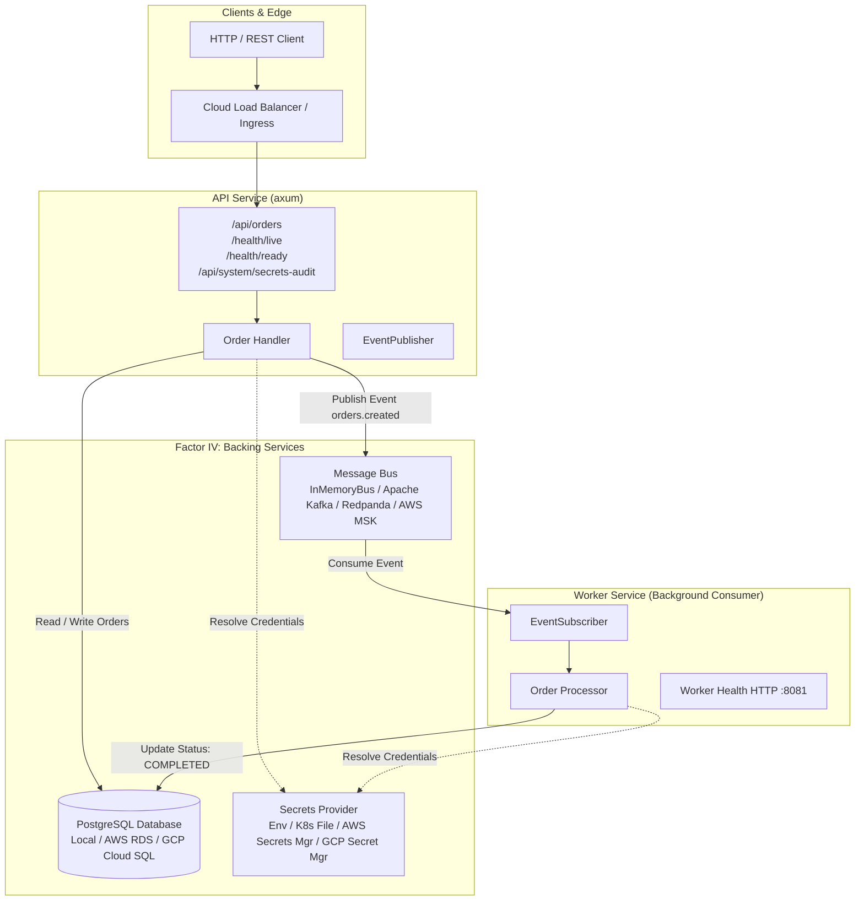

# 7ME3: Cloud-Agnostic 12-Factor Microservices Architecture

This document defines the architecture and implementation for **7ME3**, demonstrating a cloud-independent, 12-factor microservices platform in **Rust**. It runs identically on **AWS (EC2 / Nitro Enclaves)**, **Google Cloud (Compute Engine / Confidential VMs)**, **Kubernetes**, and **Bare Metal**.

---

## 1. System Architecture Overview

The system consists of a shared platform foundation crate and two containerized microservices:



### Component Structure
- [crates/platform](file:///home/tj/Code/7Me3/crates/platform): Shared abstractions for Database, Secrets, Messaging, Configuration, Lifecycle, and Telemetry.
- [services/api-service](file:///home/tj/Code/7Me3/services/api-service): High-throughput edge REST API exposing endpoints to manage orders and audit secrets.
- [services/worker-service](file:///home/tj/Code/7Me3/services/worker-service): Asynchronous downstream consumer executing business workflows triggered via message bus events.
- [deploy/](file:///home/tj/Code/7Me3/deploy): Infrastructure-as-code manifests for Kubernetes, AWS EC2, GCP Compute Engine, and Bare Metal.

---

## 2. Mapping to The 12-Factor App Principles

| Factor | Principle | 7ME3 Rust Implementation |
| :--- | :--- | :--- |
| **I. Codebase** | One codebase tracked in revision control, many deploys | Single Cargo workspace containing [platform](file:///home/tj/Code/7Me3/crates/platform), [api-service](file:///home/tj/Code/7Me3/services/api-service), and [worker-service](file:///home/tj/Code/7Me3/services/worker-service). |
| **II. Dependencies** | Explicitly declare and isolate dependencies | Declared strictly in [Cargo.toml](file:///home/tj/Code/7Me3/Cargo.toml) with isolated multi-stage Docker builds. |
| **III. Config** | Store config in the environment | [AppConfig](file:///home/tj/Code/7Me3/crates/platform/src/config.rs) parses environment variables and dynamically expands `secret://<key>` URI references. |
| **IV. Backing services** | Treat backing services as attached resources | PostgreSQL ([database.rs](file:///home/tj/Code/7Me3/crates/platform/src/database.rs)) and Kafka/In-Memory Messaging ([messaging/](file:///home/tj/Code/7Me3/crates/platform/src/messaging)) are attached via connection URLs and interface traits. |
| **V. Build, release, run** | Strictly separate build and run stages | Multi-stage Dockerfiles ([api-service/Dockerfile](file:///home/tj/Code/7Me3/services/api-service/Dockerfile), [worker-service/Dockerfile](file:///home/tj/Code/7Me3/services/worker-service/Dockerfile)) produce minimal, unprivileged runtime containers. |
| **VI. Processes** | Execute the app as stateless processes | Zero shared local disk or session state in memory; all state is persisted to PostgreSQL and message broker. |
| **VII. Port binding** | Export services via port binding | Axum web server self-hosts on `$PORT` (default 8080) and `$WORKER_HEALTH_PORT` (default 8081). |
| **VIII. Concurrency** | Scale out via the process model | Worker services consume using Kafka consumer groups (`orders.created`), scaling horizontally without code modifications. |
| **IX. Disposability** | Maximize robustness with fast startup and graceful shutdown | [ShutdownSignal](file:///home/tj/Code/7Me3/crates/platform/src/lifecycle.rs) captures `SIGINT` / `SIGTERM`, draining in-flight requests before exit. |
| **X. Dev/prod parity** | Keep development, staging, and production as similar as possible | [docker-compose.yml](file:///home/tj/Code/7Me3/docker-compose.yml) provides identical local backing services (PostgreSQL + Redpanda Kafka). |
| **XI. Logs** | Treat logs as event streams | [telemetry.rs](file:///home/tj/Code/7Me3/crates/platform/src/telemetry.rs) outputs structured JSON streams to `stdout` (`LOG_FORMAT=json`), ingested by CloudWatch, GCP Cloud Logging, or Datadog. |
| **XII. Admin processes** | Run admin/management tasks as one-off processes | Idempotent migrations runner ([database.rs:run_migrations](file:///home/tj/Code/7Me3/crates/platform/src/database.rs)) executes at boot or via migration CLI. |

---

## 3. The Three Core Abstractions

### 3.1 Database Access (PostgreSQL)
The database layer ([crates/platform/src/database.rs](file:///home/tj/Code/7Me3/crates/platform/src/database.rs)) wraps `sqlx::PgPool`:
- **Attached Resource**: Swappable connection string (`DATABASE_URL`).
- **Connection Pooling**: Configurable `min_connections`, `max_connections`, connection timeout, and idle timeout.
- **Health Probing**: `ping()` executes `SELECT 1` used by Kubernetes and Cloud Load Balancer readiness probes (`/health/ready`).
- **Secret Interpolation**: Connection strings support dynamic secret resolution (e.g. `postgres://user:secret://DB_PASSWORD@host:5432/db`).

### 3.2 Secrets Management (`SecretProvider`)
The secrets contract ([crates/platform/src/secrets/mod.rs](file:///home/tj/Code/7Me3/crates/platform/src/secrets/mod.rs)) decouples application code from physical secret stores:

```rust
#[async_trait]
pub trait SecretProvider: Send + Sync {
    fn provider_name(&self) -> &'static str;
    async fn get_secret(&self, key: &str) -> Result<String, SecretError>;
    async fn resolve_reference(&self, value: &str) -> Result<String, SecretError>;
}
```

Implemented providers:
1. **[EnvSecretProvider](file:///home/tj/Code/7Me3/crates/platform/src/secrets/env.rs)**: Reads from environment variables (`SECRETS_PROVIDER=env`).
2. **[FileSecretProvider](file:///home/tj/Code/7Me3/crates/platform/src/secrets/file.rs)**: Reads from projected directories (`SECRETS_PROVIDER=file`). Used for Kubernetes Secret Volume Mounts (`/etc/secrets`) and Confidential VM volatile ramdisks (`/run/secrets`).
3. **[AwsSecretsManagerProvider](file:///home/tj/Code/7Me3/crates/platform/src/secrets/aws.rs)**: Reads directly from AWS Secrets Manager using IAM Role / EC2 IMDSv2 (`SECRETS_PROVIDER=aws`, feature `aws`).
4. **[GcpSecretManagerProvider](file:///home/tj/Code/7Me3/crates/platform/src/secrets/gcp.rs)**: Queries GCP Secret Manager REST API with OAuth2 tokens from GCE Metadata Server / Workload Identity (`SECRETS_PROVIDER=gcp`, feature `gcp`).

### 3.3 Inter-Service Messaging (`EventPublisher` & `EventSubscriber`)
Messaging ([crates/platform/src/messaging/mod.rs](file:///home/tj/Code/7Me3/crates/platform/src/messaging/mod.rs)) enables asynchronous event streams:

```rust
#[async_trait]
pub trait EventPublisher: Send + Sync {
    fn publisher_name(&self) -> &'static str;
    async fn publish(&self, topic: &str, key: Option<&str>, payload: &[u8]) -> Result<(), MessagingError>;
}

#[async_trait]
pub trait EventSubscriber: Send + Sync {
    fn subscriber_name(&self) -> &'static str;
    async fn subscribe(&self, topic: &str, group_id: &str, handler: Arc<dyn EventHandler>) -> Result<(), MessagingError>;
}
```

Implemented backends:
1. **[InMemoryEventBus](file:///home/tj/Code/7Me3/crates/platform/src/messaging/in_memory.rs)**: Pure Tokio-based pub/sub for zero-infrastructure local development and automated integration tests.
2. **[KafkaBus](file:///home/tj/Code/7Me3/crates/platform/src/messaging/kafka.rs)**: Production-grade Apache Kafka / Redpanda / AWS MSK / GCP Managed Kafka client (feature `kafka`).

---

## 4. Confidential Computing & Bare Metal Hardening

In confidential computing environments (AWS Nitro Enclaves, AMD SEV-SNP, Intel SGX/TDX) and high-security bare metal setups, disk persistence of secrets represents a severe vulnerability.

### 7ME3 Protections:
1. **Volatile Memory Staging (tmpfs)**:
   - Under `SECRETS_PROVIDER=file`, secrets are read from `/run/secrets/` or `/dev/shm/secrets/`, which are mounted as non-swappable volatile RAM (`tmpfs`).
   - Secrets are attested and decrypted directly into RAM and never written to physical block storage.
2. **Masked Audit Endpoints**:
   - The `/api/system/secrets-audit` endpoint validates secret availability across cloud providers while strictly masking the payload (`ab****yz`), preventing memory dumps or log leakage.
3. **Non-Root Sandboxing**:
   - Containers run under UID `10001` (`appuser`).
   - Bare metal systemd units enforce `ProtectSystem=strict`, `ProtectHome=true`, `PrivateTmp=true`, and `NoNewPrivileges=true`.

---

## 5. Quickstart & Local Verification

### 5.1 Run Backing Services
```bash
# Start PostgreSQL and Redpanda Kafka
docker compose up -d postgres redpanda
```

### 5.2 Run API Service
```bash
cargo run -p api-service
```

### 5.3 Run Worker Service
```bash
cargo run -p worker-service
```

### 5.4 Test API Endpoints
```bash
# 1. Health check (Liveness & Readiness)
curl -s http://localhost:8080/health/live
curl -s http://localhost:8080/health/ready

# 2. Verify Secrets Abstraction
curl -s http://localhost:8080/api/system/secrets-audit | jq .

# 3. Create an Order (Persisted to DB & Published to Message Bus)
curl -s -X POST http://localhost:8080/api/orders \
  -H "Content-Type: application/json" \
  -d '{"customer_name": "Global Corp", "amount_cents": 59900, "currency": "USD"}' | jq .

# 4. List Orders
curl -s http://localhost:8080/api/orders | jq .
```

---

## 6. Multi-Environment Deployment

### Kubernetes
```bash
kubectl apply -f deploy/k8s/configmap-secrets.yaml
kubectl apply -f deploy/k8s/api-deployment.yaml
kubectl apply -f deploy/k8s/worker-deployment.yaml
```

### AWS EC2 & Nitro Enclave
Refer to [deploy/aws/user-data.sh](file:///home/tj/Code/7Me3/deploy/aws/user-data.sh) for systemd service and IAM role configuration.

### GCP Compute Engine & Confidential VM
Refer to [deploy/gcp/startup-script.sh](file:///home/tj/Code/7Me3/deploy/gcp/startup-script.sh) for GCE metadata service account and Secret Manager setup.

### Bare Metal Hardening
Refer to [deploy/baremetal/7me3-api.service](file:///home/tj/Code/7Me3/deploy/baremetal/7me3-api.service) for sandboxed systemd configuration.
